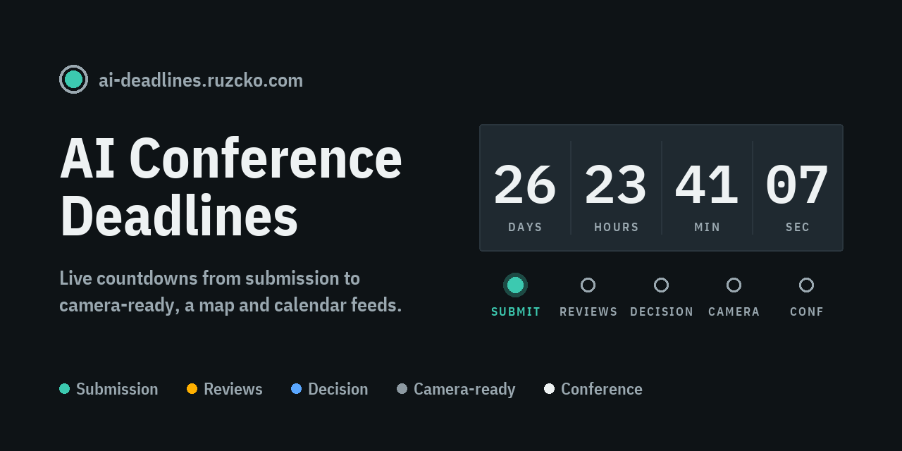
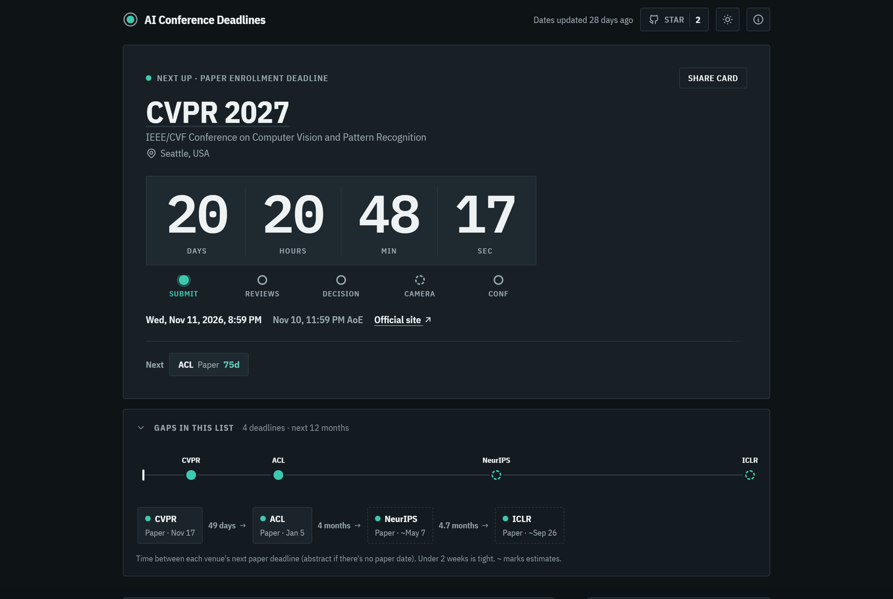
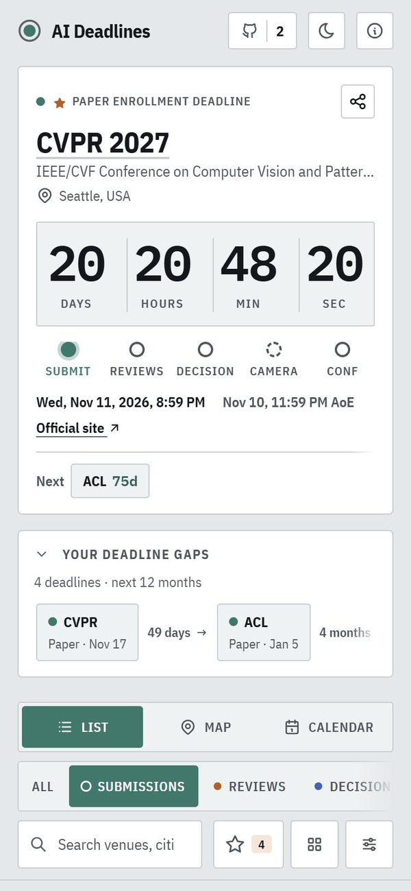

<p align="center">
  <a href="https://ai-deadlines.ruzcko.com"></a>
</p>

<p align="center">
  <a href="https://ai-deadlines.ruzcko.com"></a>
  <a href="https://github.com/ruzcko/ai-deadlines/actions/workflows/refresh.yml"></a>
  <a href="https://github.com/ruzcko/ai-deadlines/actions/workflows/scrape.yml"></a>
  <a href="https://github.com/huggingface/ai-deadlines"></a>
  <a href="https://github.com/ruzcko/ai-deadlines/stargazers"></a>
</p>

# AI Conference Deadlines

Live countdowns to AI/ML conference milestones (submission, reviews, decision,
camera-ready, conference) with a map of host cities, a month calendar, share cards
and per-milestone calendar feeds. Live at https://ai-deadlines.ruzcko.com

Dates come from two sources: [huggingface/ai-deadlines](https://github.com/huggingface/ai-deadlines)
(MIT), and our own weekly read of each venue's official page. Dates both list are
cross-checked ("✓ 2 sources" / "⚠ Sources differ"); official-page dates fill gaps
(host cities, conference dates, editions not listed yet) and are tagged "Official".
Fix wrong Hugging Face dates upstream; report wrong official-page reads here.

## Screenshots

<p align="center">
  
</p>
<p align="center">
  
</p>

## How it works

- `pipeline/sync.py` pulls the upstream YAML, normalizes milestone types into
  groups and all timezones to UTC, projects **estimated** next editions for
  venues whose dates aren't announced yet, and writes:
  - `site/data/conferences.json` for the page
  - `site/cal/{all,submission,reviews,decision,camera,conference}.ics` feeds
    (estimated dates are never put in the feeds)
- `pipeline/scrape_official.py` (daily, GitHub Actions, needs `GEMINI_API_KEY` from
  Google AI Studio's free tier, which allows ~20 calls a day) fetches the pages in
  `data/official_sources.json`, has Gemini (`gemini-3.8-flash`, JSON-schema output)
  extract the dates, and commits `data/official/<venue>.json`. Each run spends a
  budget of 18 calls on the venues never read, then the stalest; unchanged pages
  are skipped by content hash. `pipeline/official.py` merges those
  files into the site data. Run it by hand for a few venues with
  `python pipeline/scrape_official.py cvpr iclr` (or from the Actions tab).
- `site/` is a static page (no build step, no dependencies).

## Run locally

```bash
python -m venv .venv
.venv/Scripts/python.exe -m pip install -r requirements.txt
.venv/Scripts/python.exe pipeline/sync.py
.venv/Scripts/python.exe -m http.server 8773 --directory site
```

## Deploy

Any static host that can run `pipeline/sync.py` at build time and serve `site/`
works. `.github/workflows/refresh.yml` checks upstream every 6 hours and pushes
`data/upstream.lock` when it changed, which triggers a rebuild.

## Credits

See [site/credits.html](site/credits.html) (served at `/credits.html`) for every source and licence:
Hugging Face ai-deadlines (MIT) data and our own reads of official pages, with our changes described;
OpenStreetMap/Nominatim (ODbL) coordinates; Natural Earth (public domain); Leaflet (BSD-2);
Inter (OFL); resvg-wasm (MPL-2.0). Full licence texts live in `site/licenses/`.
